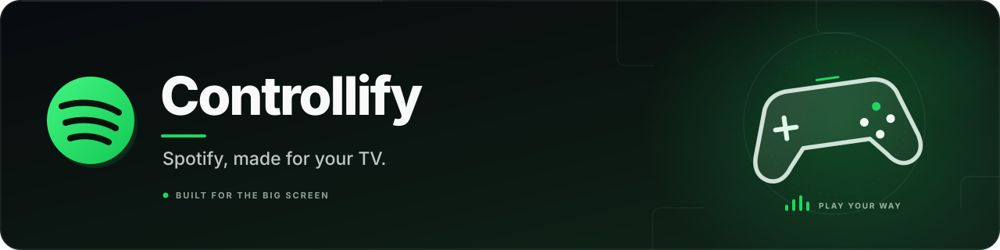
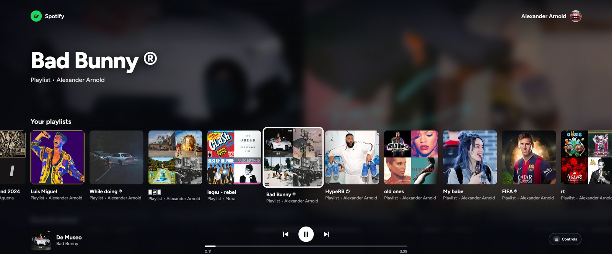

# Controllify

> ### 💚 Support the project
> Controllify is free and always will be. If you enjoy it, a donation helps me keep working on it and **create more options, apps, and features**. Donations are completely optional and don't unlock anything.
>
> **[Donate with PayPal](https://paypal.me/Valadal)**
>
> 💬 Have an idea, a suggestion, or a proposal for a new app or feature? Send it to me on Discord: **@valadal**

---

A Spotify interface designed for TVs and game controllers, including Xbox and PlayStation. You can also use it with a keyboard.

**Open Controllify here:** https://valadal.github.io/Controllify/

> Unofficial project. Not affiliated with Spotify AB. Spotify is a trademark of Spotify AB.

## Features

- Browse your playlists, Liked Songs, recently played tracks, and top artists.
- Open playlists and view their tracks.
- Control the app with a game controller or keyboard.
- Navigate using the menu and view cover art in full screen.
- Floating **Controls** bubble with a compact on-screen help panel.
- Windows media integration (SMTC): song, cover art, and playback buttons show up in the Windows media overlay and in themes that read it.
- Controller input is ignored while another window or overlay (like a launcher menu) is in front.
- **Close app** option in Settings.
- Install it as an app on your computer.

## Before you start

You need:

- **Spotify Premium** to play music through the web player.
- A compatible browser, such as Chrome or Edge.
- Your own **Spotify Client ID**. Creating an app in the Spotify Developer Dashboard is free.

## First-time setup

Each person must connect their own Spotify account and use their own Client ID. You do not need to install anything or run the page on your computer.

### 1. Create a Spotify app

Creating the app is how you get your own **Client ID**. It is free and takes about two minutes. Everything happens on the [Spotify for Developers](https://developer.spotify.com) site:

1. Go to **[developer.spotify.com](https://developer.spotify.com)** and log in with your Spotify account.
2. Click your profile name (top right) and choose **Dashboard**, or open the [Dashboard](https://developer.spotify.com/dashboard) directly.
3. Click **Create app**.
4. Enter any name and description (for example, "Controllify").
5. In **Redirect URIs**, add `https://valadal.github.io/Controllify/` (see step 2 below).
6. If prompted to choose products or APIs, enable **Web API** and **Web Playback SDK**.
7. Accept the terms and click **Save**.
8. Open your new app and go to **Settings**. Your **Client ID** is shown under **Basic Information**.

### 2. Set the Redirect URI

In your Spotify app settings, find **Redirect URIs** and add this exact address:

`https://valadal.github.io/Controllify/`

Save your changes. The address must match exactly, including the final `/`.

### 3. Copy your Client ID

1. In the [Spotify Dashboard](https://developer.spotify.com/dashboard), open your app, go to **Settings → Basic Information**, and copy your **Client ID**.
2. Do not copy or share your **Client Secret**.
3. Open [Controllify](https://valadal.github.io/Controllify/).
4. Paste your Client ID into the setup screen.
5. Follow the instructions to connect your Spotify account and authorize access.

**That's it!** After the initial setup, open the same page whenever you want to use Controllify. Your Client ID and access tokens are stored in your browser, not in this repository.

## Install Controllify as an app

If you'd rather open it like an app instead of a browser tab:

1. Open [Controllify](https://valadal.github.io/Controllify/) in Chrome or Edge.
2. Open the browser menu.
3. Look for **Install page as app** or **Install this site as an app**.
4. Once installed, launch Controllify from its new icon.

To enter full-screen mode, press `F` or `F11`. You can also press **Start** inside the app.

## Controls

Press **Menu ☰ / OPTIONS**, the `H` key, or click the floating **Controls** bubble to see the controls on screen.

| Action | Xbox | PlayStation | Keyboard |
|---|---|---|---|
| Move | D-pad / left stick | D-pad / left stick | Arrow keys |
| Play / open | A | ✕ | Enter |
| Back | B | ○ | Backspace |
| Pause / resume | X | □ | Space |
| Previous / next track | LB / RB | L1 / R1 | P / N |
| Open menu | Y | △ | M or Esc |
| Volume | Right stick ↑↓ | Right stick ↑↓ | + / − |
| Seek 10 seconds | Right stick ←→ | Right stick ←→ | , / . |
| View cover art | View | CREATE | V |
| Show controls | Menu ☰ | OPTIONS | H or ? |
| Pause / resume controller input | Guide / Home | PS button | — |
| Full screen | — | — | F / F11 |

## Compatibility

- **Windows with Chrome or Edge and an Xbox controller:** full support.
- **PlayStation controllers:** work in desktop browsers.
- **Xbox console browser:** the interface and controller may work, but playback depends on browser compatibility.
- **Windows media controls (SMTC):** work in Chrome and Edge on Windows.

## Known limitations

- Spotify only allows the app to list tracks from playlists you own or collaborate on. For some other playlists, the app may play music without displaying the track list.
- The app loads up to the first 100 tracks of a playlist and the first 50 Liked Songs.
- **Close app** can only close the window when Controllify runs as an installed app or an app window. In a regular browser tab, the browser blocks it and you will need to close the tab yourself.

## Privacy

Controllify uses **Authorization Code with PKCE**, so it does not need a server or a Client Secret. Your Client ID and access tokens are stored only in your browser's local storage (`localStorage`).

To disconnect your account, open **Settings** in Controllify and sign out.

## Support the project

If Controllify is useful to you, you can support its development with a [PayPal donation](https://paypal.me/Valadal). It helps me keep creating more options and new projects.

Ideas, feedback, or proposals for new apps and features are always welcome: find me on Discord as **@valadal**.

## License

MIT License. See the [LICENSE](LICENSE) file.
